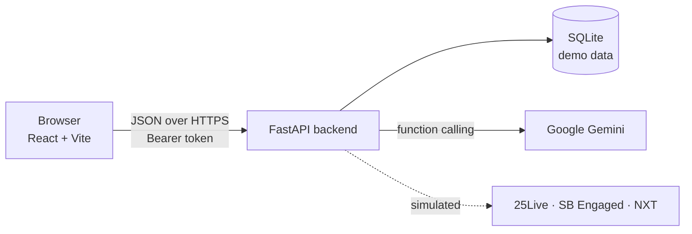

<div align="center">


# ClubOS

**One place to run your Stony Brook club.**

Events, tasks, chat, campus approvals, budgets, vendors and emails, connected in one workspace,
with an AI assistant that helps the board get the work done.

[**Open the live demo**](https://clubos-delta.vercel.app) · [API docs](https://clubos-api-one.vercel.app/docs) · [Frontend guide](docs/FRONTEND_GUIDE.md)


</div>

---

## Contents

- [Why ClubOS](#why-clubos)
- [Try it in 30 seconds](#try-it-in-30-seconds)
- [What you can do](#what-you-can-do)
- [The AI assistant](#the-ai-assistant)
- [A 3-minute demo tour](#a-3-minute-demo-tour)
- [Run it on your computer](#run-it-on-your-computer)
- [Configuration](#configuration)
- [How it fits together](#how-it-fits-together)
- [Project structure](#project-structure)
- [Testing](#testing)
- [Deploying](#deploying)
- [Troubleshooting](#troubleshooting)
- [About the data](#about-the-data)
- [Roadmap](#roadmap)
- [Team](#team)

---

## Why ClubOS

Running a student club at Stony Brook means juggling a group chat, a spreadsheet of tasks, 25Live for rooms,
SB Engaged for event approval, NXT for money, a vendor's email thread, and a dozen reminders, all in different places.
Nobody can see at a glance whether the next event is actually ready.

ClubOS puts all of it on one board. Every event gets a **readiness score** that pulls together its tasks and its
university paperwork, chat messages turn into tasks with one click, the budget updates the moment an expense is added,
and an AI assistant can plan an event's to-do list and hand out the work for you to approve.

---

## Try it in 30 seconds

1. Open **https://clubos-delta.vercel.app**
2. Sign in with a demo account:

| Who | Email | Password | Good for |
|---|---|---|---|
| **SBCS President** | `eduardo.lozanonaranjo@stonybrook.edu` | `Sbcs!President26` | The full demo, including finances |
| SBCS Treasurer | `sbcs.treasurer@sbu.clubos` | `Sbcs$Treasury26` | Money: expenses and NXT requests |
| SBCS Brand Manager | `sbcs.brand@sbu.clubos` | `Sbcs^Brand26` | Seeing what non-finance roles can't do |
| Multi-club member | `marcus@sbu.clubos` | `Marcus%Build26` | The club switcher (Robotics + Design) |

All accounts are listed in [`docs/demo-accounts.csv`](docs/demo-accounts.csv).

> **Tip:** the demo data resets whenever the server restarts. You can also reset it yourself:
> click your name in the top right, then **Reset demo data**.

---

## What you can do

| Screen | What it's for |
|---|---|
| **Dashboard** | The home screen. What matters right now: the next event and how ready it is, club stats, upcoming events, open tasks, items waiting on the university, the budget, and a live activity feed. |
| **Events** | Every event as a card with its date, place and readiness. Create new events in a couple of fields. |
| **Event workspace** | Everything about one event on one page: tasks, 25Live / SB Engaged / NXT status, budget and expenses, vendors, its chat channel and email drafts. |
| **Tasks** | A drag-and-drop board (To Do, In Progress, Completed). Filter by event or "assigned to me", reassign in one click. |
| **ClubChat** | Channels for the board. Pick any message and turn it into a task; ClubOS posts a note in the channel when you do. |
| **Approvals** | Campus paperwork in one place: room reservations (25Live), event approval (SB Engaged) and funding (NXT), with document checklists and a step-by-step tracker. |
| **Finance** | Annual budget, category bars, recent expenses and NXT requests. Adding an expense updates every total immediately. Only the President and Treasurer can change money. |
| **Vendors** | Caterers, printers, photographers and rentals with contacts, estimates, and which events they're linked to. |
| **Emails** | Pick a template and an event and ClubOS writes the email from the event's real details. Polish it with AI, then open it in your mail app. Nothing is ever sent for you. |
| **Members** | The executive board, each person's responsibilities, and a workload view that shows who has room for more. |

**Across the whole app**

- **Multiple clubs:** belong to several boards and switch between them from the sidebar.
- **Dark mode:** the sun/moon button in the top bar (or on the login page). It remembers your choice and otherwise follows your computer's setting.
- **Roles:** everyone on the board can plan, chat and manage tasks; money changes need the President or Treasurer.
- **Calm by design:** the "Reduce effects" switch in your user menu turns animations down on slower laptops.

---

## The AI assistant

Click **Assistant** in the top bar. Ask in plain English, for example:

- *"Plan the remaining tasks for the End-of-Semester Celebration"*
- *"Turn #event-planning into tasks"*
- *"What's left before Fall Tech Networking Night?"*
- *"Who has the most open tasks? Rebalance them"*
- *"Draft the invite for the AI Workshop"*

The assistant looks things up before it acts. It checks the event, the board's workload and existing tasks, so it
spreads work fairly and doesn't create duplicates.

**Nothing changes until you confirm.** Every change it wants to make appears as a card with **Confirm** and **Reject**,
plus **Confirm all** when there are several. It can propose:

- creating, updating, reassigning or deleting tasks
- posting a message in a chat channel
- saving an email draft
- adding an expense, creating an NXT request, or moving an approval forward
  (money cards can only be confirmed by the President or Treasurer)

It runs on Google Gemini. If no key is configured, the button shows "Coming soon" and the rest of the app works normally.

---

## A 3-minute demo tour

1. **Sign in as the SBCS President.** You land on the Dashboard: Fall Tech Networking Night is 75% ready.
2. **Open the event.** The workspace shows its 8 tasks (5 done), the approved room, the pending SB Engaged form and the catering quote.
3. **Assign a task** to another board member.
4. **Go to ClubChat → #event-planning**, pick a message and make it a task.
5. **Approvals:** move SB Engaged to its next step and watch the readiness score go up.
6. **Finance:** add an expense and watch the budget bars update.
7. **Emails:** generate the event invitation from its details, polish it with AI, open it in your mail app.
8. **Back to the Dashboard:** every change shows up in the numbers and the activity feed.
9. **Bonus:** ask the Assistant to plan the End-of-Semester Celebration and press **Confirm all**.

---

## Run it on your computer

You need **Python 3.12+**, **Node.js 20.19+** (or 22+) and **git**.

```bash
git clone https://github.com/Nabeehaj/ClubOS.git
cd ClubOS
```

### 1. Start the backend (terminal 1)

**Windows**

```bash
cd backend
python -m venv .venv
.venv\Scripts\activate
pip install -r requirements-dev.txt
copy .env.example .env
uvicorn app.main:app --reload
```

**Mac / Linux**

```bash
cd backend
python3 -m venv .venv
source .venv/bin/activate
pip install -r requirements-dev.txt
cp .env.example .env
uvicorn app.main:app --reload
```

The API is now at **http://localhost:8000**. Open **http://localhost:8000/docs** for interactive docs: click
*Authorize*, sign in with a demo account, and try any endpoint. The database is created and filled with demo data
automatically the first time.

> Want the AI features? Get a free key at [Google AI Studio](https://aistudio.google.com/apikey) and paste it into
> `backend/.env` after `GEMINI_API_KEY=`, then restart the backend. The key stays on your computer; `.env` is never committed.

### 2. Start the frontend (terminal 2)

```bash
cd frontend
npm ci
npm run dev
```

Open **http://localhost:5173** and sign in. That's it.

### Handy commands

| Where | Command | What it does |
|---|---|---|
| `backend/` | `python -m app.seed` | Wipe the database and reload the demo data |
| `backend/` | `pytest -q` | Run the backend tests |
| `frontend/` | `npm run lint` | Lint the frontend |
| `frontend/` | `npm run build` | Production build into `frontend/dist` |
| repo root | `python docs/wireframes/generate.py` | Redraw the black-and-white wireframes (needs Pillow) |

---

## Configuration

### Backend: `backend/.env`

Copy `backend/.env.example` to `backend/.env`. Every setting is optional.

| Variable | Default | What it does |
|---|---|---|
| `GEMINI_API_KEY` | *(empty)* | Turns on the AI assistant and AI email polish |
| `GEMINI_MODEL` | `gemini-flash-latest` | The main Gemini model |
| `GEMINI_FALLBACK_MODELS` | `gemini-3.5-flash,gemini-flash-lite-latest` | Tried in order when the main model is busy, out of quota or retired |
| `GEMINI_THINKING_BUDGET` | `0` | Model "thinking" per call. `0` keeps replies to a few seconds |
| `JWT_SECRET` | dev value | Signs login tokens. **Set a long random value anywhere public** |
| `JWT_EXPIRE_HOURS` | `72` | How long a login lasts |
| `FRONTEND_ORIGINS` | `http://localhost:5173,http://localhost:3000` | Frontend addresses allowed to call the API |
| `DATABASE_URL` | `sqlite:///backend/clubos.db` (`/tmp` on Vercel) | Where the data lives |

### Frontend: `frontend/.env`

| Variable | Default | What it does |
|---|---|---|
| `VITE_API_URL` | `http://localhost:8000` | Where the backend lives. Public, not a secret |

---

## How it fits together



- **Frontend** (`frontend/`): React 19, React Router, TanStack Query for data and caching, Tailwind CSS v4,
  Framer Motion for motion, Radix UI for accessible menus and dialogs, dnd-kit for the task board.
  Every request goes through one file, [`src/lib/api.js`](frontend/src/lib/api.js).
- **Backend** (`backend/`): FastAPI with SQLModel on SQLite, bcrypt passwords and JWT logins. Every club screen
  lives under `/api/clubs/{club_id}/...`, and the server checks that you're on that club's board.
- **AI**: the assistant uses Gemini *function calling*. It can read club data through tools, and every change is
  saved as a proposal that only runs when a person confirms it, through the same code (and permission checks) as
  the app's own buttons.
- **One-call screens**: the Dashboard and the Event workspace each load with a single request, which keeps them fast.

The full API contract for frontend work is in [`docs/FRONTEND_GUIDE.md`](docs/FRONTEND_GUIDE.md) and
[`docs/openapi.json`](docs/openapi.json).

---

## Project structure

```
ClubOS/
├── backend/                  Python API (FastAPI)
│   ├── app/
│   │   ├── main.py           App setup, CORS, health check, demo reset
│   │   ├── config.py         Settings read from .env
│   │   ├── models.py         Database tables
│   │   ├── auth.py           Passwords, login tokens, club access checks
│   │   ├── services.py       Shared queries, readiness score, budget totals
│   │   ├── ai.py             Gemini client with retries and model fallback
│   │   ├── seed.py           Demo data (SBCS + two sample clubs)
│   │   └── routers/          One file per feature:
│   │                         auth, clubs, dashboard, events, tasks, chat,
│   │                         approvals, finance, vendors, emails, agent (AI)
│   ├── tests/                End-to-end tests of the demo flow
│   ├── requirements.txt      Runtime packages
│   └── requirements-dev.txt  + test and tooling packages
├── frontend/                 React app (Vite)
│   ├── public/               Favicon and club logos
│   └── src/
│       ├── pages/            One file per screen
│       ├── components/       Building blocks, grouped by screen
│       │   ├── assistant/    AI assistant panel
│       │   ├── shell/        Sidebar, top bar, club switcher, theme toggle
│       │   └── ui/           Buttons, dialogs, badges, rings, toasts…
│       └── lib/              API client, auth, theme, formatting, motion
└── docs/
    ├── FRONTEND_GUIDE.md     Screens → endpoints, rules for the UI
    ├── demo-accounts.csv     Every demo login
    ├── openapi.json          Machine-readable API spec
    └── wireframes/           Wireframe generator (images are shared separately)
```

More detail: [backend/README.md](backend/README.md) · [frontend/README.md](frontend/README.md)

---

## Testing

```bash
cd backend
pytest -q
```

The tests walk through the whole demo on a fresh database: logging in with every account, the dashboard,
assigning tasks, chat-to-task, approvals and readiness, finance permissions, email templates, the AI assistant's
proposals and Confirm all (with Gemini replaced by a script), and the model fallback chain.

---

## Deploying

The live demo runs on Vercel as two projects built from this repo's `main` branch. **Every push to `main`
redeploys both automatically.**

| Project | Root directory | Address | Settings |
|---|---|---|---|
| `clubos` | `frontend` | https://clubos-delta.vercel.app | `VITE_API_URL` = backend address |
| `clubos-api` | `backend` | https://clubos-api-one.vercel.app | `JWT_SECRET`, `FRONTEND_ORIGINS`, `GEMINI_API_KEY` |

On Vercel the backend keeps its SQLite database in temporary storage, so changes reset when the server restarts.
That's ideal for a demo. For data that lasts, point `DATABASE_URL` at a hosted database.

---

## Troubleshooting

<details>
<summary><b>"Can't reach ClubOS" on the login screen</b></summary>

The frontend can't find the backend. Make sure `uvicorn app.main:app --reload` is running in `backend/`, and that
`VITE_API_URL` (if you set one) points at it.
</details>

<details>
<summary><b>Port 5173 (or 8000) is already in use</b></summary>

Another app is using it. Stop that app, or run on another port, for example `npm run dev -- --port 3000`
(already allowed by the backend) or `uvicorn app.main:app --port 8001`.
</details>

<details>
<summary><b>The Assistant button says "Coming soon"</b></summary>

No Gemini key is set. Add `GEMINI_API_KEY` to `backend/.env` (or to the Vercel project's environment variables)
and restart or redeploy the backend.
</details>

<details>
<summary><b>"AI is busy right now, try again in a minute"</b></summary>

Gemini is overloaded or the free daily quota is used up. ClubOS already retries and falls back to other models
automatically. Wait a minute, or use a different free key while testing. Quotas reset daily.
</details>

<details>
<summary><b>AI fails with a certificate error on Windows</b></summary>

Some antivirus "web shields" (for example Avast) inspect HTTPS traffic. ClubOS uses your computer's own certificate
store to handle this. Make sure you reinstalled requirements after pulling (`pip install -r requirements-dev.txt`).
</details>

<details>
<summary><b>My changes disappeared</b></summary>

The demo database resets when the server restarts, or when someone clicks **Reset demo data**. That's expected for the demo.
</details>

<details>
<summary><b>The browser shows a CORS error</b></summary>

The backend only accepts requests from addresses in `FRONTEND_ORIGINS`. Add your frontend's address there and
restart the backend.
</details>

---

## About the data

- **SBCS** (Stony Brook Computing Society) is the main demo club. Its president comes from the club's data;
  the other six seats are placeholders named after SBCS's real positions until the full board is confirmed.
- The **Robotics** and **Design & Media** clubs, their members, and all vendors are **fictional samples**.
  Vendors are not verified SBU-approved businesses.
- **25Live, SB Engaged and NXT are simulated.** ClubOS doesn't connect to the real systems; those records are marked
  `simulated` and their reference numbers start with `SIM-`.
- Emails are never sent automatically. ClubOS only prepares drafts and opens them in your own mail app.

---

## Roadmap

- [ ] Import real club data from the data partner's CSV
- [ ] Fill in the full SBCS executive board
- [ ] A persistent hosted database for the live site
- [ ] `@clubos` mentions in ClubChat to ask the assistant from a channel
- [ ] Notifications for upcoming deadlines

---

## Team

Built for a Stony Brook University hackathon.

| Area | Who |
|---|---|
| Backend, API and AI assistant | [@Nabeehaj](https://github.com/Nabeehaj) |
| Frontend and UI/UX | [@dan-daniyaal](https://github.com/dan-daniyaal) |
| Club data | Club data partner |

Questions or ideas? [Open an issue](https://github.com/Nabeehaj/ClubOS/issues).
